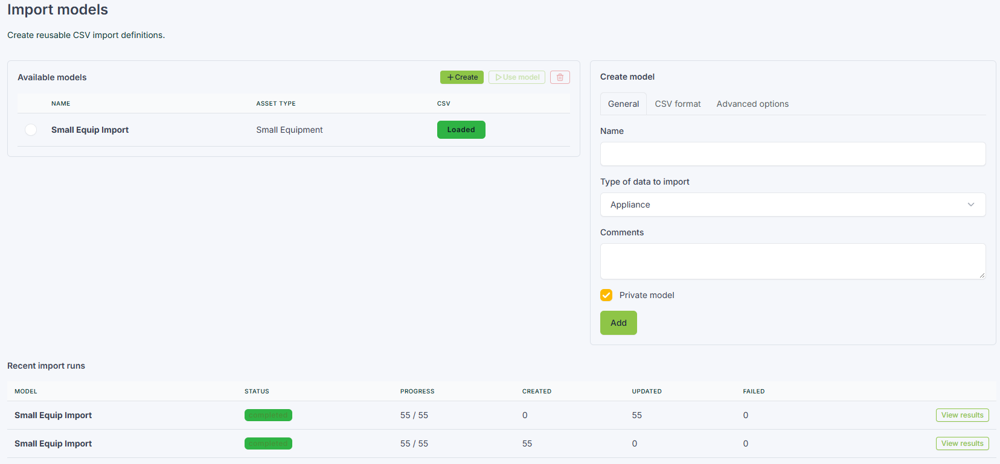
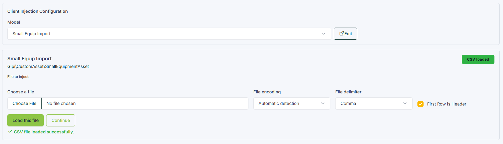
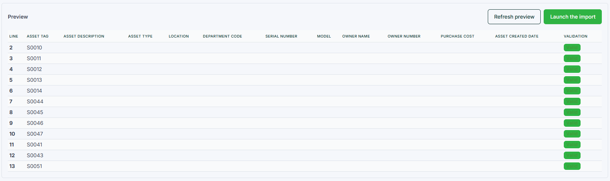
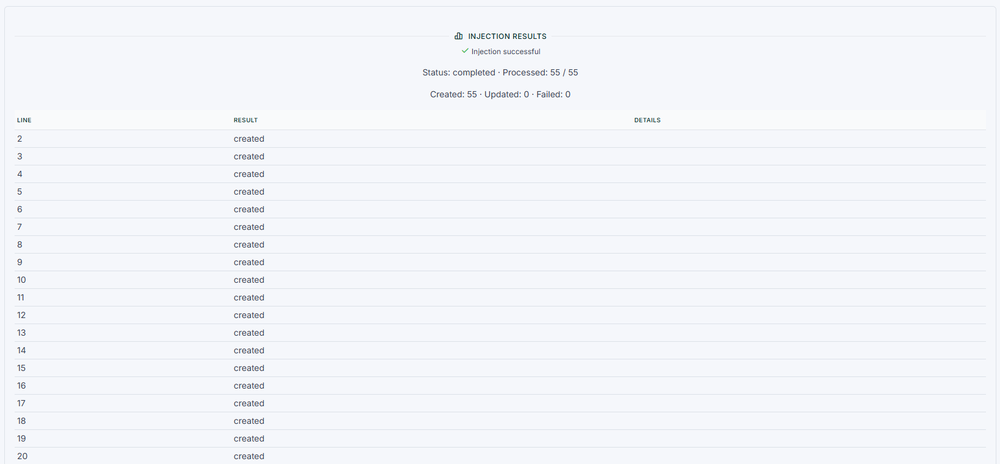

# GLPI Inject

Import CSV data into standard and custom GLPI assets with reusable import models. GLPI Inject helps administrators map, preview, validate, and run imports while using GLPI's own item APIs and permissions.

**Latest release:** [0.1.0-beta.12](https://github.com/CarltonTrailCollege/glpi-inject/releases/tag/v0.1.0-beta.12) · **Status:** Beta

> Beta software: real-installation integration coverage and cross-session import reliability are still limited. Review [known limitations](#beta-status-and-limitations) before using it for operational data.

## At a glance

- Reusable models for standard assets and active GLPI custom asset types.
- CSV upload with delimiter, header, and encoding options.
- Reviewable field-mapping suggestions, manual mapping, and row validation.
- Duplicate matching, controlled create/update behavior, and per-row results.
- Import history, progress, cancellation, and failed-row export.

## Screenshots

**Create and manage models**



**Upload a CSV**



**Preview imported rows**



**Review import results**



## Install

GLPI Inject supports GLPI **11.0.8 and later in the GLPI 11 series**. Use the PHP version supported by your GLPI installation.

1. Download the [latest release archive](https://github.com/CarltonTrailCollege/glpi-inject/releases/download/v0.1.0-beta.12/glpiinject-0.1.0-beta.12.tar.gz).
2. Extract the `glpiinject` directory into your GLPI `plugins/` directory.
3. In GLPI, open **Setup > Plugins**, then install and activate GLPI Inject.
4. Give the intended administrators the GLPI configuration permissions required to access the plugin.

For deployment from a Debian GLPI host, the repository includes an installer. It copies the plugin, then runs GLPI's console as the web-server user:

```bash
sudo bash scripts/install-debian.sh --glpi-dir /var/www/glpi --web-user www-data
```

Replace `/var/www/glpi` and `www-data` with values for your server. The GLPI console and PHP CLI must be available on that host. Do not run this deployment script from a Windows development checkout unless the GLPI path is actually mounted there.

## Import workflow

1. Create a model, choose the asset type, and configure its CSV and import options.
2. Select the model in **Import CSV**, upload the file, and configure its delimiter, encoding, and header row.
3. Review the suggested mappings. Apply suggestions only fills blank mappings with a single unambiguous match; saved or manually selected mappings are left unchanged. Choose uncertain or unmatched fields yourself.
4. Set required values and duplicate-matching behavior, then save the mapping.
5. Review the preview and validation messages. Launch the import only when the mappings and sample rows look right.
6. Follow progress and inspect the per-row results. Failed rows can be exported for correction.

## Mapping and validation

### Suggestions and destinations

Suggestions compare CSV headers with fields available for the selected asset type. Matching ignores case and punctuation and supports simple singular/plural variations. Suggestions are not saved automatically; **Apply suggestions** fills eligible dropdowns, and **Save mapping** persists the reviewed choices.

The selected mapping option also determines the GLPI destination. For linked fields such as Location, User, Budget, and Supplier, the importer resolves the reference and stores its ID in the appropriate relation field. Budget and Supplier values are stored in the asset's financial information (Infocom).

### Required values

The **Required** checkbox means a mapped CSV value cannot be blank for an imported row. A blank value fails that row; it does not change whether the GLPI field is required elsewhere in GLPI.

### References and preview

- Referenced values must resolve uniquely within the applicable entity scope. Ambiguous matches fail rather than selecting an arbitrary record.
- Tree dropdowns such as Locations try a full hierarchy path before a leaf-name lookup. Use the full path when names are duplicated.
- If **Allow creation of dropdowns** is enabled and GLPI permissions allow it, eligible missing dropdown values may be created during import. Preview does not create them, and Entities are never created.
- User mappings try username first, then an exact first-name plus last-name match. The full-name match must be unique and readable; user accounts are never created.
- Preview checks only the displayed rows and reflects database state at preview time. Choose 1, 10, 50, 100, 500, 1,000, or 10,000 rows. Imports still process the full file.
- Date and number values are normalized using the model's configured formats. For ambiguous dates such as `5/8/2026`, choose the intended order in the model settings.
- The saved upload is the snapshot GLPI imports. Re-upload the CSV to use changes made to the original file; the current successful upload time is shown with the model.

## Beta status and limitations

This is beta software. Current compatibility claims are limited to GLPI 11.0.8 and later in the GLPI 11 series. The automated tests include provider and importer regressions, but they do not replace end-to-end testing against real GLPI installations and databases.

The importer is not fully transactional, and different user sessions are not protected by database-level coordination. A later failure can leave earlier writes in place, and simultaneous runs or dropdown creation may race. Avoid running the same model concurrently or editing/replacing its CSV while an import is active. Integration coverage, concurrency protection, and failure recovery remain tracked hardening work; see [SECURITY.md](SECURITY.md).

## Development

The quality checks use the pinned Composer and npm tools:

```bash
composer install
npm ci
composer check
```

PHPStan uses a sibling GLPI 11 checkout. For local analysis, place the GLPI `11.0/bugfixes` branch at `../glpi-core`:

```bash
git clone --depth 1 --branch 11.0/bugfixes https://github.com/glpi-project/glpi.git ../glpi-core
```

Build a release archive from the repository root with:

```bash
php scripts/package-release.php
```

Release tags use the `v<version>` format and must match `PLUGIN_GLPIINJECT_VERSION` in `setup.php`. Pushing a matching tag runs the packaging workflow and publishes a GitHub prerelease.

## Security and support

Report suspected vulnerabilities through [GitHub private vulnerability reporting](https://github.com/CarltonTrailCollege/glpi-inject/security/advisories/new). Use [GitHub Issues](https://github.com/CarltonTrailCollege/glpi-inject/issues) for bugs and feature requests.

CSV uploads and import logs may contain personal or inventory data. Restrict access to the plugin, protect GLPI backups and its document directory, and define an appropriate retention policy. Uninstalling the plugin removes its models, import history, logs, and uploaded CSV files.

GLPI Inject is licensed under [GPL-2.0-or-later](LICENSE). Catalog metadata is maintained in [glpiinject.xml](glpiinject.xml).
